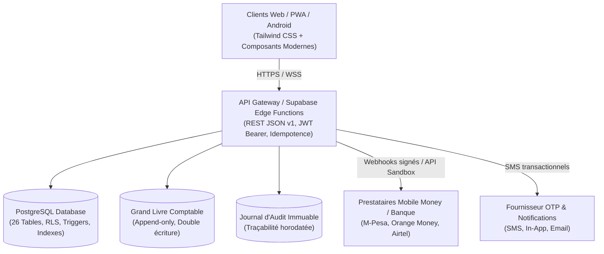

# TontiTrust - Architecture Technique de Référence

> **Référence PRD & TSD** : TT-PRD-TSD-001 v1.0  
> **Date** : 2026-07-28  
> **Statut** : Document d'architecture de référence MVP Pilote & Démo  

---

## 1. Vue d'Ensemble

TontiTrust est une plateforme fintech panafricaine conçue pour moderniser et sécuriser l'épargne collective traditionnelle (tontines / ROSCA) sans détention directe des fonds par l'application. Elle orchestre, documente et rapproche les opérations financières exécutées via des prestataires de paiement agréés (Mobile Money : M-Pesa, Orange Money, Airtel Money).

---

## 2. Découpage en Modules Métier

| Module | Responsabilités Métier & Techniques |
| :--- | :--- |
| **Identity & Access** | Authentification par OTP téléphonique (`FR-AUTH-001`), gestion des profils et sessions (`FR-AUTH-002`), consentement RGPD/CGU (`FR-AUTH-004`), KYC progressif (`FR-AUTH-005`). |
| **Tontine Management** | Cycle de vie des groupes : Brouillon (`DRAFT`), Recrutement (`RECRUITING`), Prêt (`READY`), Actif (`ACTIVE`), Suspendu (`PAUSED`), Terminé (`COMPLETED`). Verrouillage de l'ordre (`BR-004`). |
| **Scheduling & Rotation** | Calcul automatique du calendrier, attribution unique d'un bénéficiaire par cycle (`BR-007`), calcul des échéances et périodes de grâce. |
| **Payment Adapter** | Abstraction multicanal (Simulateur démo, Sandbox pilote, Prestataire réel). Clés d'idempotence (`SEC-013`), traitement et déduplication des webhooks (`FR-PAY-003`). |
| **Payout Engine** | Moteur d'éligibilité à la distribution (`FR-PAYOUT-001`), contrainte d'unicité par cycle (`FR-PAYOUT-002`), clôture du cycle. |
| **Ledger & Audit** | Grand livre comptable en double-partie append-only (`BR-019`), journal d'audit des actions sensibles (`FR-REP-004`). |
| **Support & Ops** | Triage des incidents (`FR-SUP-001`), SLA, mesures conservatoires (`FR-SUP-004`), rapprochement financier (`FR-PAY-005`). |

---

## 3. Modèle de Données & RLS (PostgreSQL / Supabase)

Le schéma complet est défini dans `supabase/migrations/20260728000001_init_schema.sql` et comprend **26 tables** organisées selon le PRD §9.2 :
- **Sécurité RLS active** sur toutes les tables exposées au client (`users`, `user_profiles`, `tontines`, `memberships`, `cycles`, `contributions`, `payouts`, `notifications`, `support_tickets`, `audit_logs`).
- **Isolation stricte** : un membre ne peut consulter que les tontines et transactions dont il fait partie.
- **Transactions atomiques** pour l'approbation des membres (respect strict de `member_limit` sans surcapacité `BR-003`).

---

## 4. Stratégie d'Environnements

- **DEV / Démo** : Données synthétiques préchargées, simulateur Mobile Money instantané, logs d'audit riches.
- **STAGING / Pilote** : Sandbox prestataire, numéros SMS de test contrôlés, panel de 100 utilisateurs.
- **PRODUCTION** : Projet Supabase dédié, clés de signature webhook rotatives, MFA admin obligatoire (`SEC-007`), non-custody certifiée.
